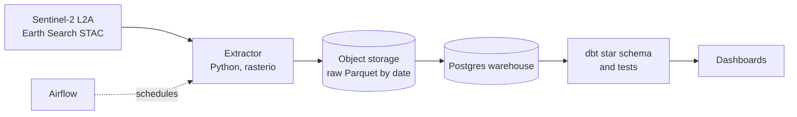

# Open Data Platform: crop monitoring, finance and health analytics

An open-source data platform built to show production-grade data engineering
practice: reproducible infrastructure, idempotent pipelines, data-quality
gates and documented design decisions. The flagship data product monitors
maize fields in Mashonaland East and West, Zimbabwe, from Sentinel-2
satellite imagery. Finance and health products will be built on the same
platform.

Author: Farai Kangara | [\[LinkedIn\]](https://www.linkedin.com/in/farai-kangara-0a09114a/) | kangara89@gmail.com

## Architecture



## Status

| Component | Status |
|---|---|
| Local platform (Postgres, S3-compatible storage, Airflow in Docker Compose) | Done |
| Sentinel-2 field extractor (cloud masking, NDVI/GCVI/NDWI, retries, quality gate) | Done |
| Airflow DAG writing Parquet to object storage | In progress |
| Postgres load, dbt star schema, data tests, lineage docs | Planned |
| Power BI and open-source BI dashboards | Planned |
| Finance product (streaming trades, regulatory and collections marts) | Planned |
| Health product (DHIS2 indicators) | Planned |
| CI (GitHub Actions), deployed demo | Planned |

## Stack

| Layer | Tool |
|---|---|
| Orchestration | Apache Airflow |
| Storage | S3-compatible object storage (Parquet), PostgreSQL |
| Extraction | Python, rasterio, pystac-client, pandas |
| Transformation and tests (planned) | dbt-core |
| Infrastructure | Docker Compose |
| Cloud equivalents | Airflow = ADF/MWAA, object storage = S3/ADLS, Postgres = RDS/Redshift |

## What the agri extractor does

For each sample field and each Sentinel-2 scene in a date range it:

- reads only the pixels inside the field polygon
- masks cloud, shadow, water and snow using the scene classification band
- computes mean NDVI, GCVI and NDWI over the valid pixels
- records `valid_pixels` and `total_pixels`, so quality travels with the data
- writes one Parquet object per acquisition date, overwritten on re-run

Engineering properties:

- **Idempotent:** re-running any date range gives identical output
- **All-or-nothing:** reads are retried, and a run that still fails writes nothing
- **Quality gate:** the run fails if an index falls outside its valid range
- **Containerised:** the same image runs on any machine

## Design decisions

All decisions are recorded as short ADRs in [`docs/adr/`](docs/adr/):

| ADR | Decision |
|---|---|
| 001 | Local open-source platform and its cloud mapping |
| 002 | Object storage image after MinIO withdrew its public images |
| 003 | Agri scope, grain and season window |
| 004 | Extraction rules, including an incident where catalogue metadata was wrong |

## Problems found and solved

- **Wrong reflectance offset.** Catalogue metadata advertised an offset that the
  pixel data did not carry, producing impossible index values. Found by
  sanity-checking output, confirmed by scanning 15 scenes, fixed, and guarded by
  an automated range check ([ADR-004](docs/adr/004-extraction-rules.md)).
- **Upstream image withdrawn.** The original object-storage image disappeared;
  the code uses the S3 API, so swapping engines needed one line
  ([ADR-002](docs/adr/002-object-storage-image.md)).
- **Host library conflicts on Windows.** Extraction runs in a container so the
  result does not depend on the machine.

## Data

All data is public: Sentinel-2 L2A imagery from the Earth Search STAC API. The
20 fields in `ingestion/agri/fields.geojson` are illustrative sample polygons,
not real farm records.

## Run it

Requires Docker Desktop.

```powershell
# platform
copy infra\.env.example infra\.env      # then set your own passwords
cd infra
docker compose up airflow-init
docker compose up -d                     # Airflow: http://localhost:8080

# extractor (from the repo root)
docker build -f infra/dev.Dockerfile -t agri-dev .
docker run --rm -v "${PWD}:/app" agri-dev python ingestion/agri/extract.py --start 2026-04-01 --end 2026-04-10
```

Output lands in `data/raw/agri/dt=YYYY-MM-DD/`.

## Repository layout

```
infra/            docker compose, Dockerfiles
orchestration/    Airflow DAGs
ingestion/agri/   field polygons and the extractor
docs/adr/         architecture decision records
```